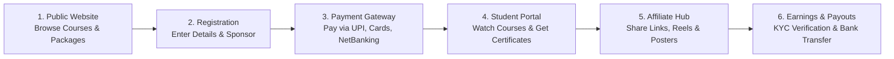
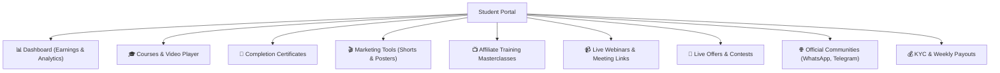
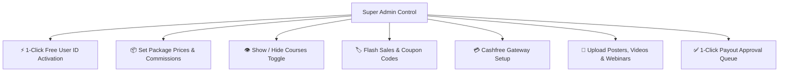

# SkillLearner: Complete Platform Walkthrough & User Guide
### *A Non-Technical, Step-by-Step Guide on How the Platform Works From the Frontend*

---

## 🌟 What is SkillLearner?

**SkillLearner** is a dual-purpose platform combining **High-Income Skill Education** and a **Two-Tier Affiliate Earning Opportunity**:

1. **For Learners:** Gain practical, career-ready digital skills (Digital Marketing, Social Media Growth, Video Editing, AI Tools, Sales Funnels, Personal Branding) structured across 5 distinct package tiers.
2. **For Affiliates:** Earn direct (Active) and team (Passive) income by sharing skill packages with others using automated marketing tools, promotional posters, live webinars, and training masterclasses.

---

## 🧭 The Complete Platform User Journey

---

## 1. Public Website: Browsing & Discovery

When visitors arrive at the website:

### 1.1 Homepage Highlights
- **Hero Presentation:** Engaging banner with introductory pitch video explaining the platform, student results, and available skills.
- **Top Notification Bar:** Shows ongoing limited-time announcements or special festival offers.
- **5 Skill Packages Display:** Clear breakdown of all 5 packages:
  1. **Basic Package (e-Lite)** — Starter skills & fundamentals.
  2. **Growth Package** — Social media mastery & organic lead generation.
  3. **Advance Package** — Video presentation, content marketing & funnel basics.
  4. **Premium Package** — Advanced digital sales, automation & scaling frameworks.
  5. **Infinity Package** — Complete master-level bundle with all courses & maximum affiliate commission rates.
- **Mentor Directory:** Profiles of industry experts and coaches who teach the courses.
- **Student Reviews & Video Testimonials:** Real video proofs, earnings screenshots, and student success stories.
- **Public Blog & Announcements:** Articles, platform news, and educational updates.

---

## 2. Registration & The Payment Security Gate

### 2.1 Signing Up
1. A new user clicks **"Enroll Now"** or opens a mentor/friend's **Affiliate Referral Link**.
2. **Sponsor Auto-Detection:** If they used a referral link, the Sponsor's name and ID are automatically filled in. If registering directly, they can enter a sponsor ID or register openly.
3. The user selects their package (Basic, Growth, Advance, Premium, or Infinity) and enters their Name, Email, Phone, State, and Password.

### 2.2 Payment & Instant Auto-Activation
- The user is redirected to the secure **Cashfree Payment Gateway**.
- They can pay using **UPI (Google Pay, PhonePe, Paytm), Credit/Debit Cards, Net Banking, or Wallets**.
- Upon successful payment:
  - The order is marked as **PAID**.
  - An official **Tax Invoice (`INV-SKL-2026-XXXXX`)** is generated.
  - An automated **Welcome Email** with login credentials and account access is sent to their inbox.
  - The student can now log in immediately.

> 🔒 **The Security Gate Rule:**  
> If someone fills the form, goes to the payment page, and then presses **Back** or closes the tab without paying, **they cannot log into the platform**. Even if they enter their email and password on the login screen, access is strictly denied until payment is completed or a Super Admin manually activates their ID.

---

## 3. Inside the Student Portal: Learning & Certification

Once logged in, the student enters the **Student Portal**:

### 3.1 Course Watching Experience
- Navigate to **"My Courses"** from the left sidebar or top mobile menu.
- All courses unlocked by their enrolled package appear as interactive cards.
- **Inside a Course:**
  - High-definition video player.
  - Structured chapter modules and sequential lessons.
  - Progress tracker showing percentage completed.
  - Lesson resources and notes.
- **Course Certificates:**
  - Once all lessons in a course are marked complete, an official **SkillLearner Certificate of Completion** is unlocked with the student's name, ready to download and share on LinkedIn or resume.

---

## 4. The Affiliate Earning Engine: How Affiliates Make Money

SkillLearner allows students to earn money by recommending packages to friends, followers, and network leads.

### 4.1 Getting Your Unique Referral Links
- On the **Dashboard**, each affiliate gets:
  - **Master Referral Link:** Directs leads to the homepage with their sponsor ID attached.
  - **Package-Specific Direct Checkout Links:** Takes leads directly to a specific package purchase page.
  - **Instant QR Code:** Can be downloaded and printed on visiting cards or shared on Instagram stories.

### 4.2 Marketing Tools: Ready-Made Shorts & Posters
Affiliates do not need to create content from scratch. They can go to **"Marketing Tools"**:
- **Shorts & Reels (9:16 Vertical Videos):**
  - High-energy video reels explaining skills, student earnings, and motivation.
  - Affiliates can preview the video directly in the browser and click **"Download Video"** to post on Instagram Reels, YouTube Shorts, or WhatsApp Status.
- **Promotional Posters & Creatives:**
  - Professionally designed graphic flyers with offers and skill previews.
  - Click **"Download Poster"** to save in original high resolution.

### 4.3 Affiliate Training Masterclasses
In the **"Affiliate Training"** section, affiliates learn step-by-step how to succeed:
- **Video Theater:** Clean YouTube-embedded masterclasses.
- **Topics Covered:**
  - Mindset & Affiliate Fundamentals.
  - How to generate 50+ organic leads daily without spending money on ads.
  - Scripting 30-second reels and teleprompter tips.
  - WhatsApp conversation closing scripts to convert inquiries into sales.
  - Objection handling techniques.

### 4.4 Live Incentive Offers & National Contests
In the **"Live Offers"** section:
- The company runs special reward contests (e.g., **"All-Expenses-Paid Goa Luxury Tour"**, **"₹25,000 Cash Milestone Bonus"**, **"Free Laptop Bonanza"**).
- Affiliates see the exact prize, qualification target (e.g., "50 Package Sales this month"), and remaining countdown days.
- **Download Poster Button:** Affiliates can download the official contest poster to broadcast on their social channels and motivate their leads to join before the deadline.

### 4.5 Live Webinars & Workshops
In the **"Live Webinars"** section:
- Top 6-figure mentors and guest coaches conduct weekly live workshops.
- Each webinar card displays the Speaker's Name, Topic, Date, and Time.
- **🚀 Join Live Meeting:** 1-click button to launch Zoom, Google Meet, or YouTube Live.
- **📥 Download Poster:** Affiliates can download the promotional webinar flyer to invite prospects to attend the live session.

### 4.6 Official Social Communities
In the **"Social Community"** section:
- Instant links to join verified company channels:
  - **WhatsApp Official Channel** (Instant alerts & broadcast announcements).
  - **Instagram Official** (Daily reels, lifestyle, and student features).
  - **YouTube Channel** (Tutorials, interviews, and public webinars).
  - **Facebook Community & Telegram Group** (Networking & peer support).

---

## 5. Financials, KYC & Getting Paid into Your Bank

### 5.1 How Commissions Work
When someone purchases a package using an affiliate's link:
1. **Active Commission (Direct):** The direct sponsor receives a substantial commission credited to their dashboard wallet immediately.
2. **Passive Commission (Tier-2):** When that new student later refers someone else, the original sponsor also receives a passive bonus commission.

### 5.2 The Earning Analytics Dashboard
- **Today's Earnings:** Revenue earned in the last 24 hours.
- **Last 7 Days:** Weekly velocity.
- **Last 30 Days:** Monthly income total.
- **All-Time Earnings:** Complete lifetime earnings.
- **Active vs. Passive Split:** Shows how much came from direct sales vs. team leverage.
- **Active Referrals List:** Full table of directly sponsored students with package details and dates.
- **Leaderboard:** Live rankings showing Top Earners of the Day, Week, Month, and All-Time.

### 5.3 KYC Submission & Bank Payouts
1. The affiliate visits the **"KYC / Profile"** section.
2. Enters their:
   - **Bank Account Number**
   - **Bank Name & IFSC Code**
   - **UPI ID** (GPay, PhonePe, Paytm)
   - Identity documents (PAN / Aadhaar) for tax compliance.
3. Once verified, the company processes weekly payout batches.
4. Affiliates check **"My Payouts"** to view their transfer history, bank transaction reference IDs, and payout dates.

---

## 6. How the Super Admin Manages the Platform (Visual Admin Tour)

Super Admins and Admins manage everything visually through intuitive buttons and forms — **no coding or developer skills needed**:

### 6.1 Free User ID Activation (Manual Override)
- If a student pays offline (cash, direct bank deposit) or is awarded a scholarship:
  - Super Admin visits `/admin/users`, finds the user, and clicks **"Activate ID"**.
  - The system instantly generates an official Tax Invoice (`INV-SKL-2026-XXXXX`), marks the account as paid, and sends the user their **Welcome Email** with login credentials.

### 6.2 1-Click User Impersonation ("Login as User")
- If an affiliate calls support saying "I cannot see my referral link" or "my video isn't loading":
  - Super Admin clicks **"Login as User"** next to their name.
  - The screen immediately opens the student's portal *exactly as that student sees it*.
  - A red bar at the top allows the admin to click **"Return to Admin"** anytime.

### 6.3 Dynamic Package Pricing & Commission Control
- Super Admin visits the **"5 Packages Pricing"** tab:
  - Can change the selling price of any package (e.g. Basic ₹999, Growth ₹1,999, Advance ₹3,499, Premium ₹5,999, Infinity ₹9,999).
  - Can change the exact **Active Direct Commission** (e.g. ₹1,400) and **Passive Commission** (e.g. ₹200) with a simple number input and click **Save**.

### 6.4 Course Show / Hide Control
- Super Admin visits **"Course Option"**:
  - A simple toggle switch to **Show** or **Hide** any course or package.
  - If a course is hidden, it immediately disappears from the public website and purchase catalog.

### 6.5 Launching Flash Sales & Coupon Codes
- **Flash Sale:** Set a 10% discount banner with a live countdown timer ticking on the website header.
- **Coupons:** Create codes like `SKILL20` (Flat ₹500 off or 20% off, set expiry date and maximum uses).

### 6.6 Cashfree Payment Gateway Setup
- Super Admin visits **"Payment Gateway"**:
  - Switch between **Test / Sandbox** and **Live Production**.
  - Paste the Cashfree App ID, Secret Key, and Webhook Secret into simple text boxes and click **Update**.

### 6.7 Uploading Marketing Content, Webinars & Offers
- **Add Marketing Tools:** Select video or photo, pick a category, choose the file from computer, and click Upload.
- **Add Webinar:** Enter Webinar Title, Speaker Name, Meeting Link (Zoom URL), upload the poster, and pick the date/time.
- **Add Live Offer:** Enter contest title, reward (Goa Trip), target sales, upload promotional poster, and set end date.
- **Add Mentors:** Type mentor name, designation, upload photo, and save.

### 6.8 Commission Payout Approval Queue
- Admin opens **"Payout Requests"**:
  - Sees a table of affiliates who requested withdrawal with their verified bank details.
  - Clicks **"Approve"** once the bank transfer is initiated, or **"Reject"** with a reason note.

---

## 7. Summary: User Experience at a Glance

| If You Are A... | Your Primary Experience |
| :--- | :--- |
| **New Visitor** | Discovers courses, watches pitch video, picks a package, registers with sponsor link, and pays via Cashfree. |
| **Enrolled Student** | Watches video lessons, tracks progress, and downloads official completion certificates. |
| **Active Affiliate** | Downloads ready-made reels & posters, shares referral links, joins webinars, attends masterclasses, and earns direct & passive commissions. |
| **Top Earner** | Climbs the public leaderboard, qualifies for Goa trips & cash contests, submits KYC, and receives weekly payouts. |
| **Admin** | Approves payouts, uploads marketing materials, schedules webinars, and supports students. |
| **Super Admin** | Owns the entire system: adjusts prices & commissions, activates IDs for free, creates coupons, configures payment gateways, and monitors platform growth. |
